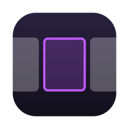
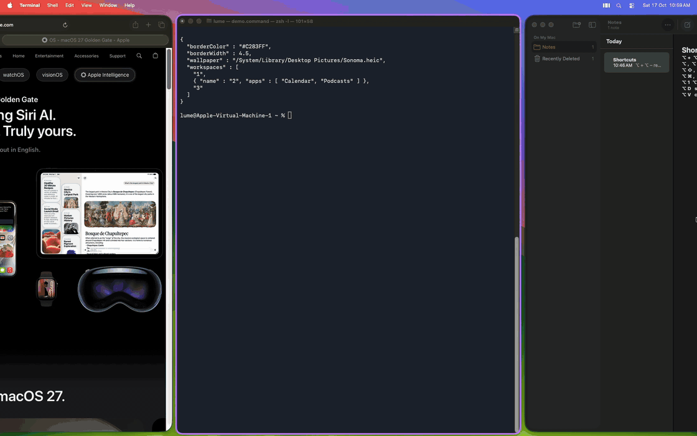
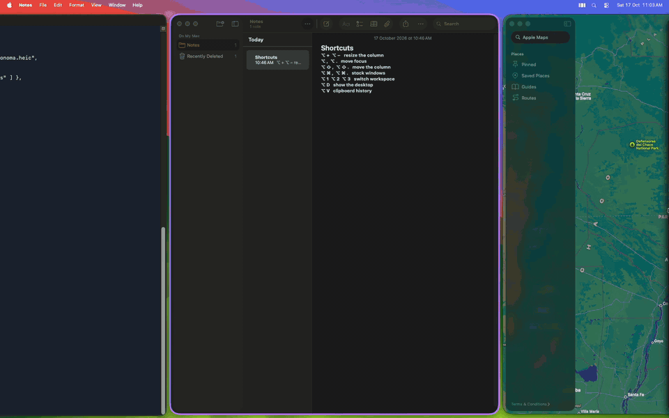
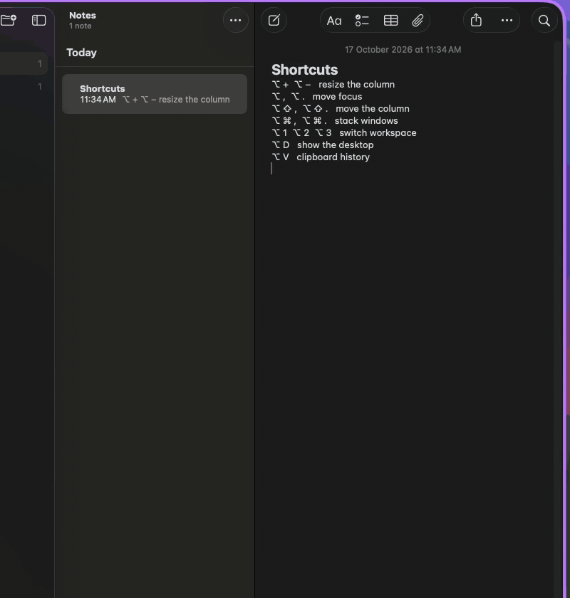
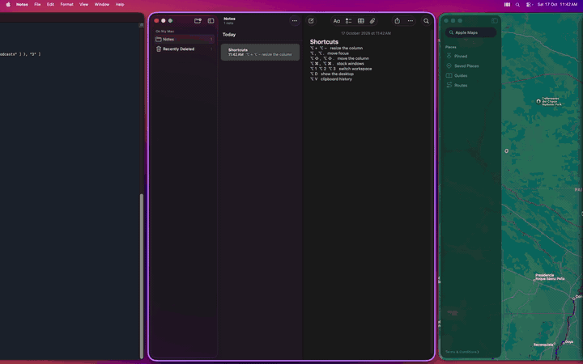
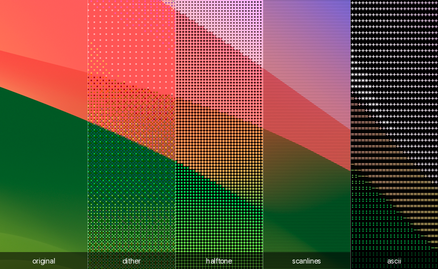
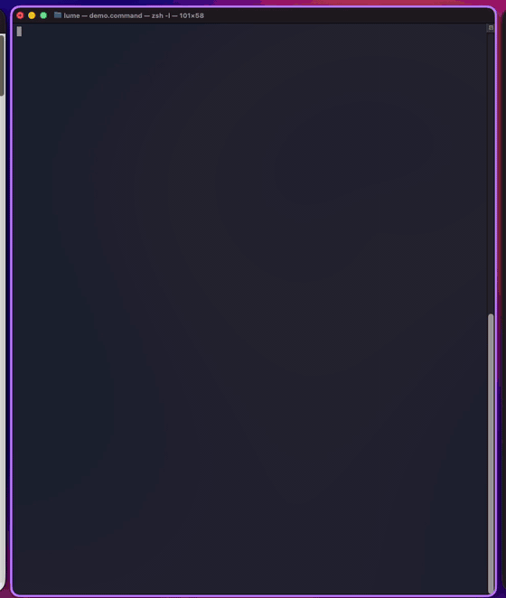
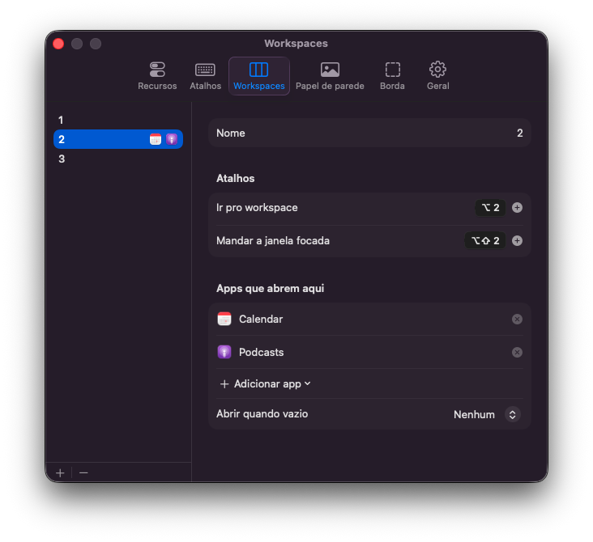
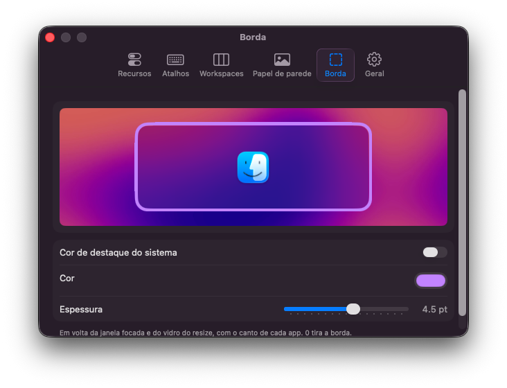

<p align="center">
  
</p>

<h1 align="center">NiriOS</h1>

<p align="center">
  Scrollable tiling, everyday tools and a desktop that looks like yours, in one light app for macOS.<br>
  Inspired by <a href="https://github.com/niri-wm/niri">niri</a>. Works with SIP on.
</p>

<p align="center">
  <b>English</b> · <a href="README.pt-BR.md">Português</a>
</p>

<p align="center">
  
</p>

NiriOS started as a tiling window manager in the style of niri and is growing into one app that fixes everyday macOS: how windows move, how the desktop looks, and the small tools the Mac doesn't ship. Every part is optional, and none of them is allowed to cost you speed or memory.

## Windows

Windows live in columns on an endless horizontal strip. Opening a window never shrinks the others: the strip just scrolls.

- **Scrolling columns.** Columns snap to 1/3, 1/2, 2/3 or full width, swap places, and can hold several windows stacked.
- **Smooth with slow apps too.** Animations follow the display's refresh rate (120 Hz on ProMotion), every app gets its own queue, and nothing is read from an app mid-animation. A slow app only delays its own windows.
- **Ghost resize.** While a column changes size, a frosted glass with the app's icon takes its place. The real window comes back once it has finished redrawing, so you never see a stretched or half-drawn frame, Electron apps included.
- **Workspaces that slide.** One strip per workspace, side by side. Apps can be pinned to a workspace, and a SketchyBar setup made for AeroSpace works with one line of config.
- **Show desktop.** Windows slide out through the nearest edge and come back with the same key.

<p align="center">
  
</p>

## Everyday tools

### Clipboard history

`⌥ V` opens your last 25 copies, text and images, right at the cursor. Type to filter, press `↩` to paste, pin up to 10 favorites with `⌘ P`. Copies that password managers mark as concealed are never saved. Nothing polls the clipboard: NiriOS only checks it after a `⌘` shortcut, a Return or a click.

<p align="center">
  
</p>

## Make it yours

### Animated wallpapers

Use a video as your wallpaper. It plays only while the desktop is showing, and runs in its own process so NiriOS stays small.

<p align="center">
  
</p>

Still images can get a pixel effect. It's rendered once and handed to macOS, so it costs nothing afterwards.

<p align="center">
  
</p>

### Focus border

A border around the focused window, with each app's own corner radius. It moves with WindowServer notifications instead of the computed layout, so it stays on the window: measured at 120 fps, it sits in place in 99.6 to 100% of frames. Color and width change as soon as you save.

<p align="center">
  
</p>

### Settings

Everything lives in one JSON file, and the menu bar icon opens a panel that writes to it. The panel is a separate process that exits when you close it.

<p align="center">
  
  
</p>

## Built to stay light

A tool you run all day has to cost close to nothing. These are rules in NiriOS, not goals:

- **Idle means idle.** No polling, no timers, no display link while nothing moves: 0% CPU.
- **Off means gone.** A feature you turn off has no window, no event monitor and no memory in NiriOS, and its shortcut goes back to your apps.
- **Heavy work runs elsewhere.** The settings panel, the clipboard reader, wallpapers and the updater are separate processes that exit when they're done, so their memory never stays behind.
- **Memory doesn't grow.** State for a window disappears with the window. After turning features on and off 60 times in a row, memory settled within the first few toggles and stayed there.
- **Stability beats features.** A glitch, a window out of place or an extra Accessibility read is a bug, even if the feature works. A change that makes the numbers below worse needs a reason.

| Measured on a MacBook Pro (Apple Silicon) | |
|---|---|
| NiriOS, idle | 10 to 12 MB, 0% CPU |
| Focus border | +0.2 to 0.5 MB |
| Clipboard history | +0.2 to 0.4 MB (a 30 MB image is read in another process and never enters NiriOS) |
| Ghost resize, during the animation | ~2.5% CPU |
| Video wallpaper, 4K at 60 fps | 32 MB and 3% CPU, in its own process |

Every measurement, and every approach that was tried and dropped, is in the [engineering notes](docs/NOTES.md) (in Portuguese).

## How it compares

| | NiriOS | [OmniWM](https://github.com/OmniNull/OmniWM) | [Paneru](https://github.com/karinushka/paneru) | [AeroSpace](https://github.com/nikitabobko/AeroSpace) | [yabai](https://github.com/asmvik/yabai) |
|---|---|---|---|---|---|
| Layout | Scrolling columns | Scrolling or dwindle | Scrolling columns | i3-like tree | BSP |
| Animations | Yes | Yes | Yes | No | Yes, with SIP partly off |
| Everything works with SIP on | Yes | Yes | Not documented | Yes | No |
| Workspaces | Own, slide sideways | Own | Native Spaces | Own | Native Spaces |
| Built-in focus border | Yes | Yes | Not documented | No | No |
| License | GPL-3.0 | GPL-2.0 | MIT | MIT | MIT |

<sub>From each project's documentation, October 2026. Corrections are welcome.</sub>

What sets the window manager apart is mostly what it refuses to do:

- **No reads during an animation.** Every Accessibility read is a round trip that blocks the app. NiriOS only writes frames while the strip moves and checks positions after it settles.
- **No pipeline per frame.** A tick is a closed-form spring and a list of rectangles. Retargeting mid-animation keeps the velocity, and a late frame doesn't bend the trajectory.
- **No focus changes mid-motion.** Activating every app you scroll past stalls them (in one test, Arc's window went 403 ms without moving), so focus moves when the strip settles.
- **No guessing.** Windows leave the layout only on real window events. A timeout isn't a closed window, and a window on another Space isn't treated as gone.

## Install

```sh
brew install --cask deandevz/tap/niri-os
```

Needs macOS 15 or later on Apple Silicon. Developed and measured on macOS 26 Tahoe. Quit other tiling window managers first.

The first launch walks you through permissions and lets you choose which features to turn on. Accessibility is required. Screen Recording is optional: with it, the ghost resize waits for the app to finish redrawing and the border measures square window corners. NiriOS checks for updates once a day and asks before installing one.

The app is self-signed and not notarized yet, so the Homebrew cask clears the quarantine flag after installing.

### Build from source

Needs Swift 6 (Xcode or the Command Line Tools).

```sh
git clone https://github.com/deandevz/NiriOS.git
cd NiriOS
./scripts/run.sh      # release build, then run; -v prints measurements for every animation
./scripts/test.sh     # layout and spring tests
```

The terminal you run it from needs Accessibility permission. `Ctrl+C` brings every window back on screen and quits.

## Shortcuts

| Shortcut | Action |
|---|---|
| `⌥ ,` `⌥ .` or `⌥ ←` `⌥ →` | Focus the column on the left or right |
| `⌥ ⇧ ,` `⌥ ⇧ .` or `⌥ ⇧ ←` `⌥ ⇧ →` | Move the column left or right |
| `⌥ +` `⌥ −` | Cycle the column width: 1/3, 1/2, 2/3, full |
| `⌥ F` | Full width; press again to go back |
| `⌥ ⌘ ,` `⌥ ⌘ .` | Stack the window into the neighboring column, or pull it out |
| `⌥ ⌘ +` `⌥ ⌘ −` | Window height in a stacked column |
| `⌥ ↑` `⌥ ↓` | Focus up or down in a stacked column |
| `⌥ 1` to `⌥ 4` | Go to a workspace |
| `⌥ ⇧ 1` to `⌥ ⇧ 4` | Send the focused window to a workspace |
| `⌥ D` | Show the desktop; press again to bring the windows back |
| `⌥ V` | Clipboard history |

Keys match by physical position, so they sit in the same place on any keyboard layout. Every shortcut can be changed.

## Configuration

Click the menu bar icon to open the settings panel, or edit `~/.config/niri-os/config.json`. Saving applies the change right away, and gaps, margins and springs animate into place. Every key is optional:

```json
{
  "gap": 12,
  "borderColor": "#C283FF",
  "borderWidth": 4.5,
  "wallpaper": "~/Movies/aurora.mp4",
  "workspaces": [
    "1",
    { "name": "2", "apps": ["Calendar", "com.hnc.Discord"] },
    { "name": "T", "apps": ["com.github.wez.wezterm"], "open": "WezTerm" }
  ],
  "shortcuts": { "toggleDesktop": ["ctrl+option+d"] },
  "onWorkspaceChange": "sketchybar --trigger aerospace_workspace_change FOCUSED_WORKSPACE=$NIRI_WORKSPACE",
  "features": { "clipboard": false }
}
```

| Key | Default | What it does |
|---|---|---|
| `gap` | `12` | Space between windows and around the screen, in points |
| `topPadding`, `bottomPadding` | `0` | Extra room, for a status bar like SketchyBar |
| `defaultColumnWidth` | `0.5` | Width of a new window, as a fraction of the screen |
| `widthPresets` | `[0.333, 0.5, 0.667, 1]` | Widths that `⌥ +` and `⌥ −` cycle through |
| `heightPresets` | `[0.333, 0.5, 0.667]` | Heights in a stacked column |
| `centerFocusedColumn` | `"always"` | `always`, `never` or `on-overflow` |
| `stiffness` | `800` | Spring stiffness; higher is faster (800 is about 0.35 s, like niri) |
| `resizeStyle` | `"ghost"` | `ghost`, `photos` (needs Screen Recording) or `live` |
| `borderColor`, `borderWidth` | system accent, `3` | `#RRGGBB`, `#RRGGBBAA` or `accent`; width `0` hides the border |
| `workspaces` | `1` to `4` | In screen order; each can set `apps`, `open` (app to launch when empty), `key` and `moveKey` |
| `onWorkspaceChange` | none | Shell command run on every switch, with the name in `$NIRI_WORKSPACE` |
| `wallpaper`, `wallpaperEffect` | none | Image or video (`.mp4`, `.mov`, `.m4v`); image effects `dither`, `halftone`, `scanlines`, `ascii` |
| `shortcuts` | | A list per action; `[]` disables it |
| `features` | all on | `tiling`, `border`, `clipboard`, `wallpaper`; `false` turns one off |

Shortcuts are modifiers (`ctrl`, `option`, `shift`, `cmd`) plus a key, like `"option+shift+left"`. Actions: `grow`, `shrink`, `growHeight`, `shrinkHeight`, `focusLeft`, `focusRight`, `focusUp`, `focusDown`, `moveColumnLeft`, `moveColumnRight`, `consumeOrExpelLeft`, `consumeOrExpelRight`, `toggleFullWidth`, `toggleDesktop` and `clipboard`. For clickable workspaces in a bar, `/Applications/NiriOS.app/Contents/MacOS/niri-os --workspace <name>` switches from the command line.

## Limitations

NiriOS is young. Expect rough edges, and please open an issue when you hit one.

- Only the main display is managed.
- No floating windows yet: every regular window joins the strip.
- Dialogs and sheets float, but aren't centered over their parent window yet.
- An app whose minimum width is wider than its column overlaps the neighbor.
- Windows of different apps can be one frame apart during an animation, since each app applies frames on its own queue.
- The settings panel and the first-launch tour are in Portuguese for now.
- NiriOS uses private SkyLight APIs (all of them work with SIP on), so a macOS update can break parts of it.

## Contributing

Issues and pull requests are welcome. [CONTRIBUTING.md](CONTRIBUTING.md) covers what the project values, the architecture rules, how to test without touching your windows, and what to include in an issue or a pull request.

## Thanks

NiriOS stands on the shoulders of [niri](https://github.com/niri-wm/niri) for the layout and animation model, [yabai](https://github.com/asmvik/yabai) for its map of the SkyLight APIs, [AeroSpace](https://github.com/nikitabobko/AeroSpace) for showing that workspaces work without disabling SIP, [OmniWM](https://github.com/OmniNull/OmniWM) and [Paneru](https://github.com/karinushka/paneru) for exploring niri on the Mac, [JankyBorders](https://github.com/FelixKratz/JankyBorders) for the corner radius approach, and [Loop](https://github.com/MrKai77/Loop) for the idea behind the ghost resize.

## License

NiriOS is free software, released under the [GNU General Public License v3.0 or later](LICENSE). You can use, study, change and share it. Any version you distribute, modified or not, has to stay open source under the same license.
